# finops-agent

Cloud cost anomaly detection, root-cause drill-down and savings advice for Azure and AWS bills, priced from the
public price lists and explained in plain words.

## What it does

It reads a company's cloud bills every day and spots spending that is out of the ordinary, such as a test server
someone forgot to switch off or a discount that quietly expired. For each one it says what changed, why, what it
has cost so far and what it will cost each month if nobody acts. It also lists the cheapest fixes, with the
saving worked out from Microsoft's and Amazon's published prices.

## A real-life example

Claire runs finance at Acme Freight, an Auckland freight company (invented for this project) that spends
about $13,000 a month across Azure and AWS. Before, she saw problems only when the monthly invoice arrived. On
10 May the one-year discount on two database servers expired. Nobody noticed, and by the end of September it had
cost $2,856 extra, $604 for every month it carried on.

With finops-agent the same change is flagged on 10 May, the day it happens. The weekly digest names the two
servers, gives the reason in one sentence and points to the data team. The same digest lists $3,707 a month of
savings, about $44,000 a year, which James on the platform team can work through: a storage tier change, two
oversized servers, idle machines and discounts worth buying. Every figure comes from the public price lists, so
Claire can check it.

## How you would use it

1. Turn on the daily cost export in Azure and AWS (both offer the FOCUS format, a standard layout for cloud bills).
2. Point finops-agent at the exported files once a day, or let a scheduled job do it.
3. Open the dashboard page it writes. Filter by team, environment or project to see spend, incidents and savings.
4. Read the Monday digest in Slack, Teams or email. Each item has a short explanation and a named owner.
5. Act on the top savings, or ask the owning team about an incident, and watch the next week's digest confirm it.

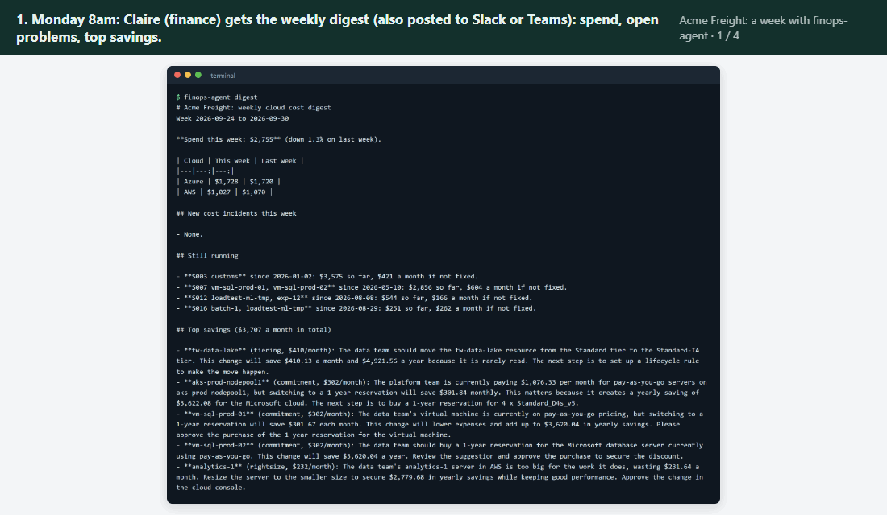

*The real-life example in four steps, using screens from a real run on the Acme Freight data: the digest, the
year of spend with incidents marked, the plain-words incident list and the priced savings list.*

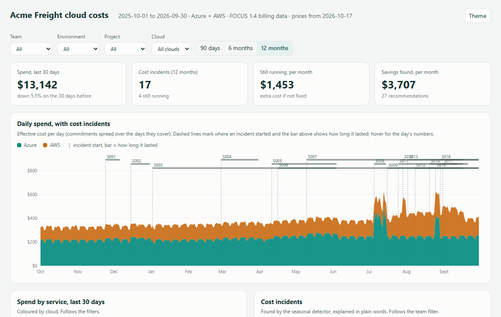

*The dashboard in use: hovering shows each day's spend and the incidents running that day; filtering to the data
team narrows every chart, incident and saving to that team.*

## Screenshots

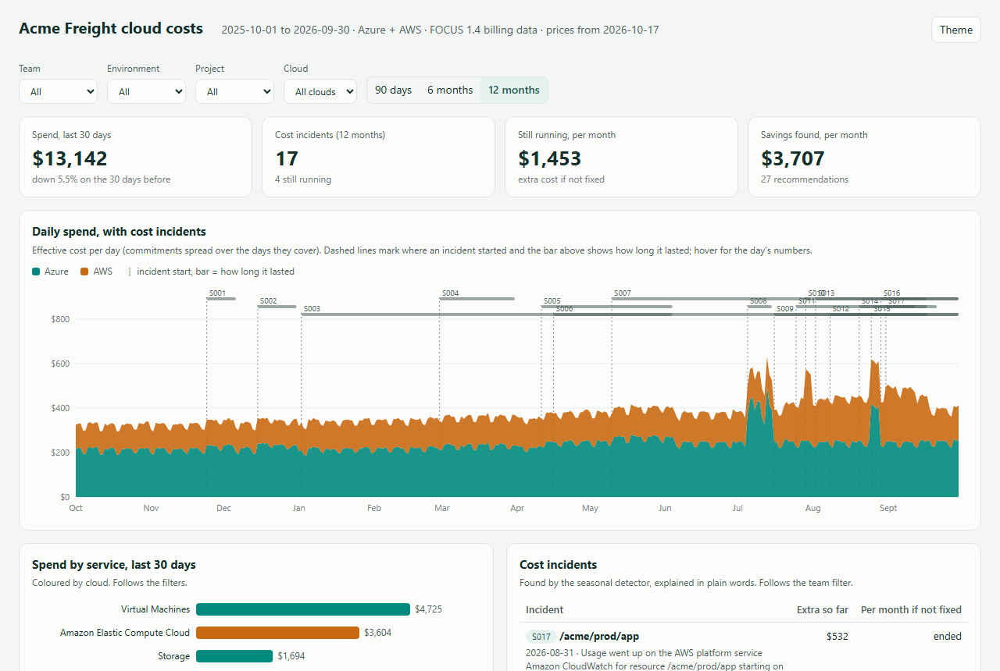

*The dashboard opens on four numbers a manager needs (spend, incidents, cost of what is still running, savings
found) above a year of daily spend. Dashed lines show where each incident started.*

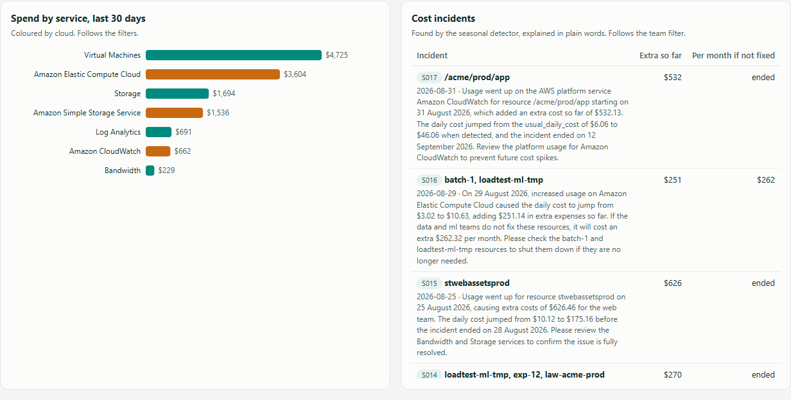

*Each incident is explained in two or three sentences written by the model. Every number in the text is checked
against the data before it is shown.*

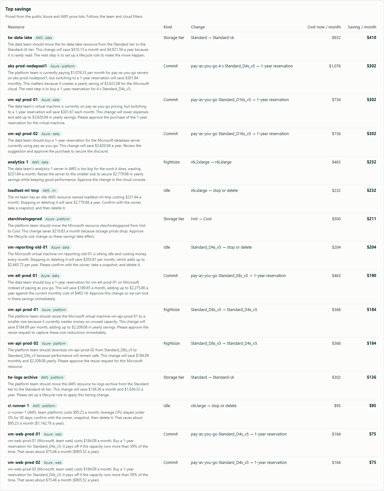

*Savings are priced from the Azure Retail Prices API and the AWS price list files, with the reason and the next
step for each.*

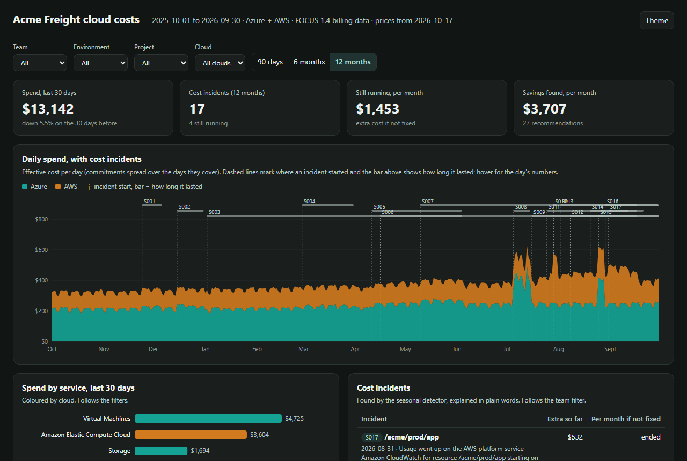

*Dark mode uses its own colour steps, checked for contrast and colour-blind separation.*

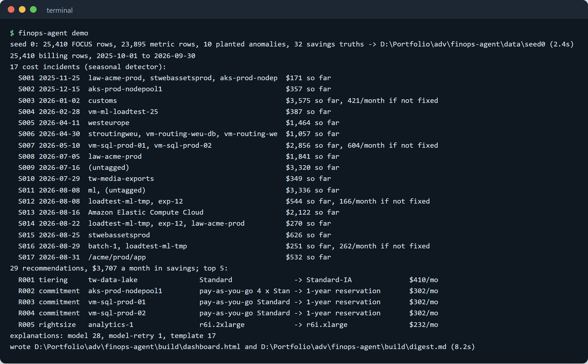

*`finops-agent demo` builds a year of data, finds 17 incidents and 29 recommendations, and writes the dashboard and
digest in about 10 seconds, with no key needed.*

## How it works

1. **Read the bills.** Billing exports in the FOCUS 1.4 layout are loaded and checked against the specification's
   rules (allowed category values, commitment rows carry a commitment ID, tags are a JSON object). Raw Azure cost
   exports in the older layout are mapped to FOCUS on the way in.
2. **Build daily series.** Cost per day is summed for every service, account, region and tag value (team,
   environment, project), about 30 series in all.
3. **Detect.** Each series is scored day by day, using only earlier days, by one of two detectors (see below).
   A run of flagged days is a segment.
4. **Drill down.** Each segment is explained by the dimension and values that carry the increase: named
   resources, a region, a tag value or an account. Segments that point to the same cause are merged into one
   incident.
5. **Measure.** For each incident: the start date, the extra cost so far, and a monthly projection if it is still
   running.
6. **Recommend.** Monitoring data (CPU, memory, disk attachment, storage reads) and the bills drive five kinds of
   recommendation, each priced from the public price lists.
7. **Explain.** The model writes a short explanation from a small table of facts. A checker rejects any text with
   a number that is not in the facts; the model gets one retry, then a template takes over.
8. **Report.** A self-contained dashboard page and a weekly Markdown digest, which can be posted to a Slack or
   Teams webhook.

### Architecture

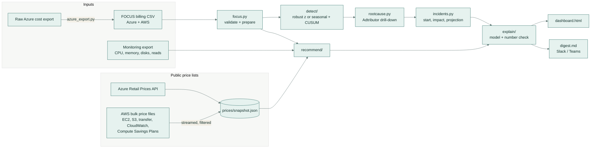

### Main flow for one incident

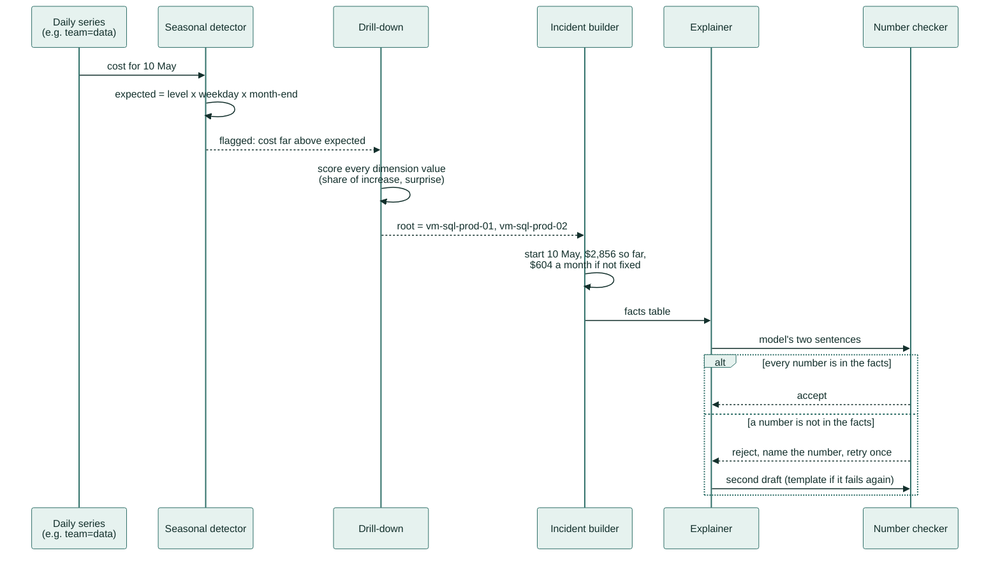

## The data

**Input format.** [FOCUS](https://focus.finops.org) (FinOps Open Cost and Usage Specification) is the open
standard for cloud billing data; Azure, AWS and Google Cloud can all export it. The project uses the 1.4 column
names (`BilledCost`, `EffectiveCost`, `ListCost`, `ChargePeriodStart`, `ServiceProviderName`, `ServiceName`,
`RegionId`, `ResourceId`, `PricingCategory`, `CommitmentDiscountId`, `SubAccountName`, `Tags` and others). The
analysis uses `EffectiveCost`, which spreads prepaid commitments over the days they cover, so an expiring
reservation shows up as a price change on the day it expires.

**The invented company.** The generator (`finops_agent/generator/`) writes a year of daily billing for Acme Freight
Freight (1 October 2025 to 30 September 2026): about 25,000 FOCUS rows across 2 Azure subscriptions and 3 AWS
accounts in the New Zealand regions, 66 resources (VMs, an AKS node pool, disks, storage, egress, logs), tags
for team, environment and project, and one Azure reservation. Costs use the real list prices from the snapshot.
The business has 1.5% monthly growth, quieter weekends, dev machines that only run in working hours, a month-end
billing batch, a pre-Christmas freight peak and a summer holiday dip.

**Planted anomalies.** Each seed places ten labelled incidents at random dates and sizes:

| Kind | What happens | Root cause label |
|---|---|---|
| Forgotten dev VM (x2) | a test VM left running around the clock, one per cloud | the VM |
| Egress spike (x2) | a bucket or storage account serving 8 to 30 times its normal downloads for 2 to 4 days | the bucket |
| Log ingestion explosion (x2) | debug logging left on: 4 to 9 times the normal log volume for 5 to 16 days | the log workspace |
| Misconfigured autoscaler | the AKS node pool minimum raised to 9 to 13 nodes for 8 to 24 days | the node pool |
| Untagged sprawl | 8 to 14 experiment instances launched without tags over about two weeks | `team = (untagged)` |
| Reservation expiry | the SQL servers' reservation ends; same usage, pay-as-you-go price | the two VMs |
| Region mistake | a routing stack deployed to West Europe instead of New Zealand North | `region = westeurope` |

Two **legitimate changes** are not labelled, so flagging them counts as a false positive: a planned service launch
(the customs project) and the pre-Christmas peak. Every label records the true start, end, resources, root cause and
extra cost; `truth.json` also holds the true monthly saving of every savings opportunity.

## Detection: two methods

| | Baseline: robust z-score | Seasonal + change point |
|---|---|---|
| Expected cost | median of the last 28 days | robust level since the last change point x weekday profile x month-end profile |
| Day score | (cost - median) / (1.4826 x MAD) | same, on the residual from the expected cost |
| Sustained shifts | not modelled | CUSUM on the standardised residuals; on an alarm the baseline restarts at the change point |
| Thresholds (chosen on the dev seed) | z >= 4, at least $5 above expected | z >= 5, at least $5 above expected |

Both run online: day *t* is scored with days before *t* only. STL, the usual seasonal decomposition, is centred and
uses later days, so it cannot score today's bill; the seasonal detector computes its trend and seasonal parts from
trailing windows instead. MAD (median absolute deviation) is used because one bad day should not widen the band.
Incidents with less than $50 of total extra cost are dropped as immaterial.

## Root-cause drill-down

For each flagged segment the drill-down follows Adtributor (Bhagwan et al., NSDI 2014). For every dimension value
(resource, region, account, service, pricing category, team, environment, project) it computes its share of the
increase (explanatory power) and how much its share of cost moved (Jensen-Shannon surprise). A dimension explains
the incident when at most three of its values cover two thirds of the increase. Named resources are preferred; but
when one value that was almost absent before (under 5% of expected cost, such as a new region or the untagged
slice) explains it, that value is the answer. The cause line comes from the rows themselves: new spend, a
commitment that ended (`PricingCategory` moved from Committed to Standard), more usage, or a higher unit price.

## Savings recommendations

| Kind | Rule | Priced with |
|---|---|---|
| Idle | VM averaging under 3% CPU for 30 days; disk or volume attached to nothing | on-demand price x hours, plus attached disks |
| Rightsize | smallest size in the family with projected p95 CPU <= 70% and p95 memory <= 80% | price difference x hours actually run |
| Commitment | production VM running >= 95% of the last 60 days; node-pool floor (5th percentile of daily nodes) | cheapest 1-year reservation or savings plan, with the break-even share of hours |
| Storage tier | reads under 10% of stored data per month | (hot - cool) x GB, minus retrieval charges |
| Missing tags | no team, environment or project tag | no saving: an owner for the cost |

Prices come from the **Azure Retail Prices API** (free, no key; the `2023-01-01-preview` version adds savings-plan
prices) and the **AWS bulk price list**. The S3, data-transfer and CloudWatch files for the New Zealand region are
small (0.2 to 1.6 MB) and cached whole. The EC2 file (57 MB) and the Compute Savings Plans file (92 MB) are
streamed once with `ijson`, keeping only the instance types used, so they never land on disk. In that region,
shared-tenancy EC2 commitments are sold as Savings Plans, so the 1-year no-upfront Compute Savings Plan rate is the
AWS commitment price. The snapshot used here was fetched on 17 October 2026.

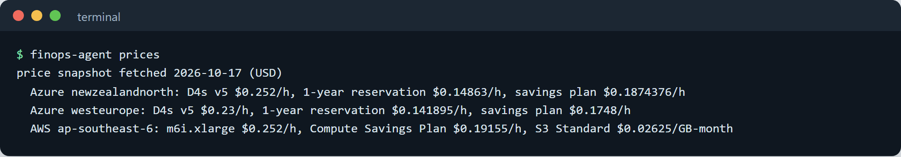

*The price snapshot: real on-demand, reservation and savings-plan rates for both clouds.*

## Plain-language explanations

Each incident or recommendation becomes a facts table (dates, money as `$1,234.56`, names, the suggested action).
The model (Gemini `gemini-flash-lite-latest` through its OpenAI-compatible endpoint) writes two or three sentences
for a manager. The number checker then pulls every number out of the text, ignores dates and names that contain
digits (`vm-sql-prod-01`, `Standard_D16s_v5`), and accepts a number only if some fact, rounded to the precision the
text shows, equals it. On a failure the model is told which numbers were wrong and gets one retry; if that fails,
the template writer is used. Without a key the template writer is used throughout, so the output is always
grounded. Model replies are cached by a hash of the prompt in `cache/llm/`, so CI and the demo replay them offline.

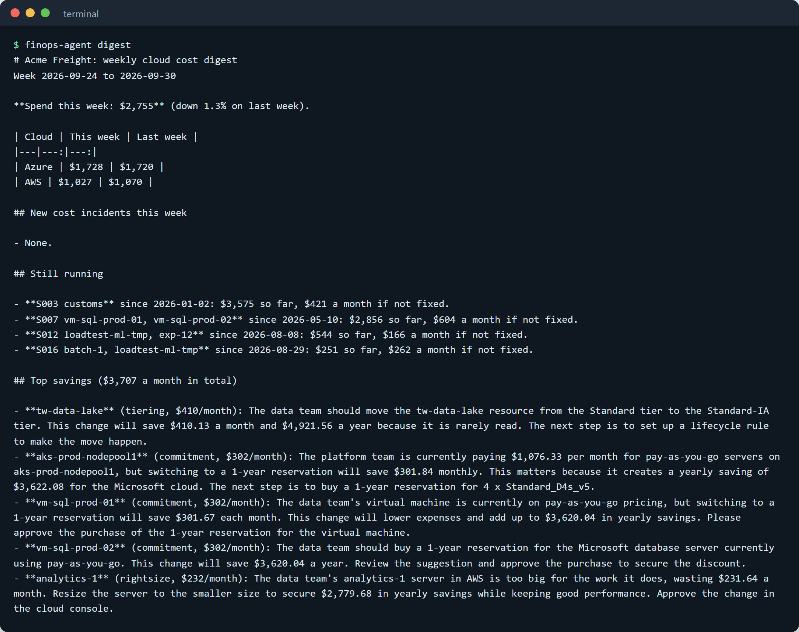

*The weekly digest: spend by cloud against last week, incidents that are still running, and the top savings with
their explanations.*

## Evaluation

**Protocol.** Seed 0 is the development seed: the detector thresholds were chosen on it from a small grid (z of
3, 3.5, 4 or 5; minimum excess of $5, $10 or $20). All detection and savings numbers below are on seeds 1 to 5
(50 planted anomalies, 10 unlabelled legitimate changes). An incident counts as a true positive when it is
detected between one day before the true start and three days after the true end, and the resources carrying its
increase include one of the label's resources. Run with `finops-agent eval` (about 4 minutes; results in
`eval/results.json`).

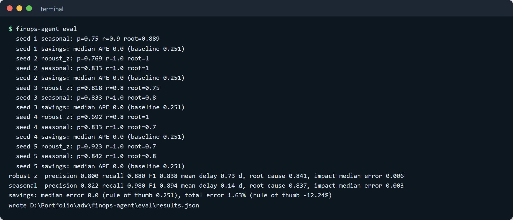

*The evaluation run: per-seed scores, then the pooled results for both detectors and the savings estimates.*

### Anomaly detection (test seeds 1 to 5)

| Metric | Robust z-score (baseline) | Seasonal + change point |
|---|---:|---:|
| Precision (incidents matching a planted anomaly) | 0.800 | **0.822** |
| Recall (planted anomalies found) | 0.880 (44/50) | **0.980** (49/50) |
| F1 | 0.838 | **0.894** |
| Mean detection delay | 0.73 days | **0.14 days** |
| False-positive incidents | **12** | 13 |
| Duplicate reports of one anomaly | **4** | 11 |
| Root-cause attribution accuracy (of those found) | 0.841 | 0.837 |
| Start-date error (mean) | 0.39 days | **0.16 days** |
| Cost-impact error (median) | 0.6% | **0.3%** |

Recall by kind (seasonal / baseline): forgotten dev VM 10/10 and 9/10, egress spike 9/10 and 8/10, log explosion
10/10 and 9/10, autoscaler 5/5 and 5/5, untagged sprawl 5/5 and 5/5, reservation expiry 5/5 and 4/5, region
mistake 5/5 and 4/5. The seasonal detector's gains come from the weekday profile (a dev VM left on over a weekend
stands out against a normal weekend, not against the weekday median) and from CUSUM (a reservation expiry adds about $20 a day
on a $240-a-day Azure bill, small on any one day). Its cost is more duplicate reports of long incidents. All 13 of
the seasonal detector's false positives are the two legitimate changes (the pre-Christmas peak and the planned
launch); 8 of the baseline's 12 are, and the other 4 are noise spikes and the tail ends of real incidents. Without
a change calendar, a planned launch looks like new spend.

Root-cause accuracy is exact: the reported dimension and values must equal the label (for example both SQL VMs,
not one). A typical miss is two incidents overlapping in time, where the drill-down names both causes together.

### Savings estimates (test seeds 1 to 5)

All 148 planted savings opportunities and 34 untagged resources were found, with no extra recommendations. The
ground truth is computed from each resource's true behaviour; the recommender sees only noisy monitoring data and
30 days of bills, so the error measures estimation from observed usage. The baseline uses rule-of-thumb shares of
current cost often quoted for each kind (idle 100%, rightsizing 30%, commitments 30%, tiering 40%).

| Monthly saving estimate | This project | Rule of thumb |
|---|---:|---:|
| Median error per recommendation | **0.0%** | 25.1% |
| Mean error per recommendation | **2.5%** | 20.3% |
| Total, all matched opportunities | $18,889 (**+1.6%**) | $16,311 (-12.2%) |
| True total | $18,586 | $18,586 |

The median is 0 because commitments for always-on VMs and idle resources are fully determined by price and hours.
The errors come from rightsizing (noisy CPU and memory peaks point one dev VM to a size one step larger than
needed, about 30% off) and from node-pool commitments (the observed floor of daily nodes is above the configured
minimum, 33% to 67% off).

### Explanation grounding

`finops-agent eval-explain --seeds 0,1` explains every incident and the top 12 recommendations on two seeds: 53
explanations, made with live model calls and now replayed from the cache.

| Metric | Result |
|---|---:|
| Grounded on the first try (every number found in the facts) | 50/53 (94.3%) |
| Grounded after one retry | 53/53 (100%) |
| Template fallbacks needed | 0 |
| Shown to the user with every number verified | 100% |
| Planted wrong numbers caught (one number in each model text changed by 13%) | 53/53 |

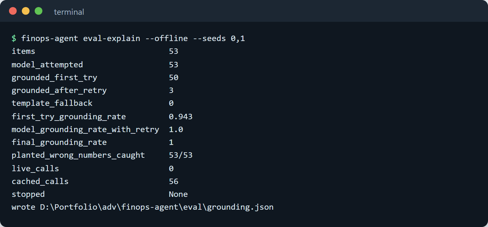

*The grounding check replayed offline from the recorded model replies.*

The checker verifies that every number exists in the facts; it does not check that a true number is attached to
the right meaning (one draft called a monthly cost a saving) or numbers written as words.

## Tech stack

- **Python 3.11+**, **pandas** and **NumPy** for the pipeline, detectors and drill-down
- **FOCUS 1.4** for the billing schema; a mapper for raw Azure cost exports
- **Azure Retail Prices API** and **AWS bulk price list** files, with **ijson** to stream the large AWS files
- **Gemini** (`gemini-flash-lite-latest`) through the OpenAI-compatible chat endpoint, called with the standard
  library; replies cached on disk
- A self-contained **HTML + SVG** dashboard (no framework, no CDN) with light and dark themes
- **Slack** incoming webhooks and **Teams** Workflows webhooks (Adaptive Card) for the digest
- **pytest**, **ruff**, **mypy**, **GitHub Actions**

## Setup

```bash
git clone https://github.com/samiulhuda360/finops-agent.git
cd finops-agent
python -m venv .venv && . .venv/bin/activate      # Windows: .venv\Scripts\activate
python -m pip install -e ".[dev]"                  # or: make setup
finops-agent demo --open                           # or: make demo
```

The demo generates seed 0 into `data/seed0/`, analyses it and writes `build/dashboard.html` and `build/digest.md`.
No key is needed: recorded model replies are replayed, and the template writer covers anything else.

### Configuration

All settings are environment variables; none are stored in files.

| Variable | Purpose |
|---|---|
| `AI_API_KEY` | key for the model endpoint; without it, explanations come from the cache or the template writer |
| `AI_BASE_URL` | OpenAI-compatible endpoint (default: Gemini's) |
| `AI_MODEL` | model name (default `gemini-flash-lite-latest`) |
| `AI_MIN_INTERVAL` | seconds between live calls (default 4.5) |
| `FINOPS_SLACK_WEBHOOK` | Slack incoming-webhook URL for `digest --post slack` |
| `FINOPS_TEAMS_WEBHOOK` | Teams Workflows webhook URL for `digest --post teams` |
| `FINOPS_HOME` | moves `data/`, `build/`, `cache/` and `eval/` (default: the repository root) |

### Usage

```bash
# your own exports: FOCUS files and/or raw Azure cost exports, plus a monitoring export
finops-agent analyze --billing exports/aws-focus.csv exports/azure-amortized.csv --metrics exports/metrics.csv

finops-agent analyze ... --method robust_z      # the baseline detector
finops-agent analyze ... --no-model             # template explanations only
AI_API_KEY=... finops-agent demo --live         # call the model for anything not in the cache

finops-agent digest                             # print the weekly digest
finops-agent digest --post teams                # post it (needs FINOPS_TEAMS_WEBHOOK)

finops-agent generate --seed 3 --out data/seed3 # another synthetic year (also writes azure_export.csv.gz)
finops-agent prices                             # show the price snapshot
finops-agent prices --refresh                   # fetch it again from Azure and AWS
finops-agent eval                               # detection and savings evaluation
finops-agent eval-explain --offline --seeds 0,1 # grounding evaluation from the cache
```

The monitoring export has one row per resource per day: `date`, `ResourceId`, and `cpu_avg`, `cpu_p95`, `mem_p95`
(VMs), `attached_to` (disks and volumes) or `read_gb` (storage).

## Project structure

```
finops_agent/
  focus.py            FOCUS 1.4 columns, validation, loading (FOCUS or raw Azure exports)
  azure_export.py     raw Azure amortized-cost export <-> FOCUS
  prices/             Azure Retail Prices API and AWS price-list clients; snapshot.json
  generator/          invented company, planted anomalies, daily simulation and ground truth
  detect/
    methods.py        robust z-score baseline; seasonal decomposition + CUSUM
    rootcause.py      Adtributor-style drill-down
    incidents.py      series, segments, merging, start date, impact, projection
  recommend/          idle, rightsize, commitment, storage tier, missing tags
  explain/
    llm.py            OpenAI-compatible client with disk cache and 429 stop
    grounding.py      number-grounding checker
    __init__.py       facts tables, prompts, retry, templates
  report/             dashboard.html template, dashboard builder, digest and webhooks
  pipeline.py         analyze -> files
  evaluate.py         matching, scoring, tuning protocol, grounding evaluation
  cli.py              finops-agent commands
cache/llm/            recorded model replies (replayed offline)
eval/                 results.json, grounding.json
tests/                38 tests
docs/                 screenshots and GIFs
```

## Tests

```bash
make test        # ruff check, ruff format --check, mypy, pytest
```

38 tests cover the price snapshot, FOCUS validation, the Azure export round trip, both detectors on constructed
series (weekly pattern, weekend spike, small sustained shift, month-end peaks), the drill-down rules, the
reservation-expiry incident end to end, savings pricing, the number checker, the retry and fallback logic, cache
replay, the digest, webhook posting to a local server and the dashboard. CI runs the same commands, the demo and
the offline grounding check on Python 3.11 and 3.13.

## Licence

MIT. See [LICENSE](LICENSE).
